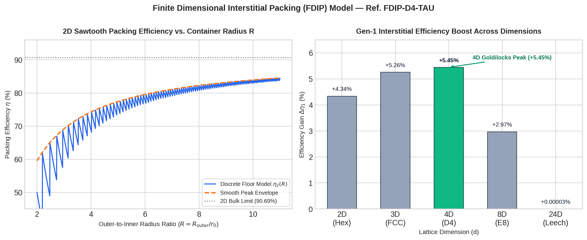

# Finite Dimensional Interstitial Packing (FDIP) Model

An analytical and Python framework for modeling finite-container hypersphere packing efficiency, discrete packing jumps, curved boundary dead-zones, and multi-generation interstitial gap-filling across dimensions ($2\mathrm{D}$ through $24\mathrm{D}$)—formulated cleanly in $\tau = 2\pi$.



## Key Highlights

* **Unified Discrete + Continuous Efficiency Equation:** Captures both jagged integer packing jumps ($\lfloor \cdot \rfloor$) and curved wall dead-zone losses $(1 - c/R)^d$ without requiring NP-hard geometric coordinate solvers.
* **The $4\mathrm{D}$ ($D_4$) Interstitial Efficiency Peak ($+5.45\%$):** Demonstrates why single-generation gap filling peaks in $4\mathrm{D}$—where deep holes widen to $r_1 = \sqrt{2} - 1 \approx 0.4142$ ($3$ holes per sphere) before the exponential $r^d$ hypervolume penalty crushes interstitial gains in $8\mathrm{D}$ and $24\mathrm{D}$.
* **Curse of Dimensionality Boundary Scaling:** Quantifies how boundary dead-zones dominate finite containers as $d$ increases (e.g., retaining $90\%$ of bulk density requires $R \ge 7.4$ in $2\mathrm{D}$, but $R \ge 114$ in $24\mathrm{D}$).

---

## Core Mathematical Equations (in $\tau = 2\pi$)

### 1. Discrete Finite-Container Efficiency (With Jumps)
$$\eta_d(R) = \frac{\left\lfloor \eta_{\mathrm{bulk}}(d) \cdot (R - c)^d \right\rfloor}{R^d}$$

### 2. Smooth Peak Efficiency Envelope
$$\eta_{\mathrm{peak}, d}(R) = \eta_{\mathrm{bulk}}(d)\left(1 - \frac{c}{R}\right)^d$$

### 3. Multi-Generation Interstitial Gap-Filling Cascade
$$\eta_m(d) = \eta_0(d)\left(1 + \sum_{i=1}^{m} N_i \, r_i^d\right)$$

### 4. Minimum Container Radius for Retention Threshold $\alpha \in (0, 1)$
$$R_{\min}(d, \alpha) = \frac{c}{1 - \alpha^{1/d}}$$

---

## Dimensional Reference Constants

| Dimension ($d$) | Optimal / Densest Lattice | Base Limit $\eta_0(d)$ | Max Hole Radius ($r_1$) | Holes / Sphere ($N_1$) | Gen 1 Limit $\eta_1(d)$ | Gen 1 Boost ($\Delta\eta_1$) |
| :--- | :--- | :--- | :--- | :--- | :--- | :--- |
| **$2\mathrm{D}$** | Hexagonal ($A_2$) | $\frac{\tau / 2}{\sqrt{12}} \approx 90.69\%$ | $0.154701$ | $2$ | $95.03\%$ | $+4.34\%$ |
| **$3\mathrm{D}$** | FCC ($A_3 / D_3$) | $\frac{\tau / 2}{3\sqrt{2}} \approx 74.05\%$ | $0.414214$ | $1$ *(oct.)* | $79.31\%$ | $+5.26\%$ |
| **$4\mathrm{D}$** | Checkerboard ($D_4$) | $\frac{(\tau / 2)^2}{16} \approx 61.69\%$ | $0.414214$ | $3$ | $67.13\%$ | **$+5.45\%$ (Peak)** |
| **$8\mathrm{D}$** | $E_8$ Lattice | $\frac{(\tau / 2)^4}{384} \approx 25.37\%$ | $0.414214$ | $135$ | $28.33\%$ | $+2.97\%$ |
| **$24\mathrm{D}$** | Leech Lattice ($\Lambda_{24}$) | $\frac{(\tau / 2)^{12}}{12!} \approx 0.1930\%$ | $0.414214$ | $196{,}560^*$ | $0.1930\%$ | $+0.00003\%$ |

---

## Repository Structure

```text
fdip-hypersphere-packing/
├── LICENSE                      # MIT License
├── README.md                    # Documentation & equations
├── requirements.txt             # Python dependencies (numpy, matplotlib)
├── fdip_model.py                # Core FDIPModel class, CLI summary & plotting
├── test_fdip_model.py           # Unit tests verifying constants & bounds
├── fdip_analysis.png            # Two-panel preview plot
├── fdip_model_equations.tex     # LaTeX reference source
└── fdip_model_equations.pdf     # Compiled PDF reference sheet
```

---

## Quickstart

### 1. Install Dependencies
```bash
pip install -r requirements.txt
```

### 2. Run the Model & Generate Plots
```bash
python fdip_model.py
```

### 3. Run Unit Tests
```bash
python -m unittest test_fdip_model.py
```

---

## Practical Applications

* **Dual-Polarization Optical & Wireless Modulation ($4\mathrm{D}$ QAM):** Hierarchical two-tier $D_4$ constellations place secondary low-priority data symbols inside the $3$ deep holes ($r_1 = 0.4142$) per lattice cell, increasing $4\mathrm{D}$ signal packing volume by $+8.83\%$ without expanding the outer power boundary.
* **Vector Quantization & AI Embedding Compression:** Coarse-to-fine $4\mathrm{D}$ $D_4$ codebooks snap smooth vectors to primary lattice points and fine residuals to deep holes, cutting worst-case distortion radius from $\sqrt{2}$ to $1.0$ while preserving fast self-similar $D_4$ decoding.
* **Granular & Polydisperse Materials Modeling:** Predicts wall-effect density loss near container boundaries for multi-size particle assemblies.

---

## Attribution & References

* **Model Name:** Finite Dimensional Interstitial Packing (FDIP) Model
* **Formulation & Synthesis:** Gemini (Google AI) — `Ref. FDIP-D4-TAU`
* **Foundational Proofs:** Lagrange (1773) & Thue (1890) [$2\mathrm{D}$], Hales (1998) [$3\mathrm{D}$], Korkin & Zolotarev (1877) [$4\mathrm{D}$ $D_4$], Viazovska et al. (2016) [$8\mathrm{D}$ $E_8$ & $24\mathrm{D}$ Leech].
