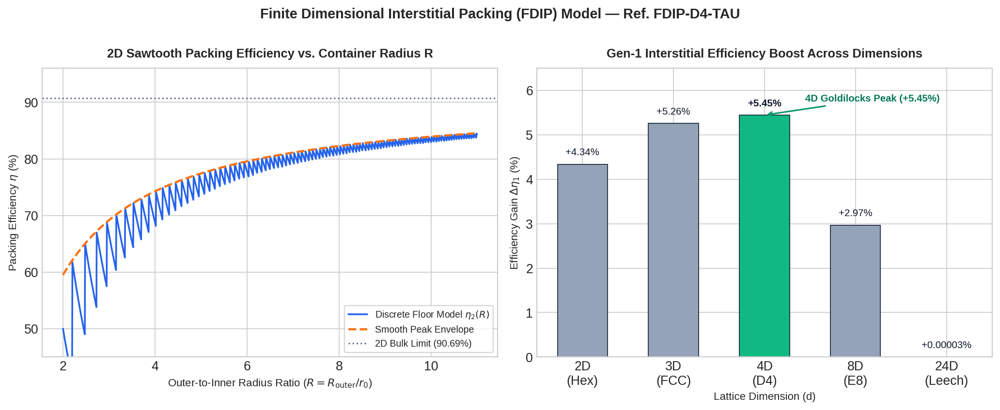

# Finite Dimensional Interstitial Packing (FDIP) Model

[](#)
[](#)
[](#)

An analytical and computational framework modeling **finite-container hypersphere packing efficiency** across spatial dimensions $d \ge 2$, unifying discrete integer packing jumps, curved boundary dead-zones, and multi-generation interstitial void filling in $\tau = 2\pi$.



---

## Overview

Classical sphere-packing theorems establish upper density bounds for **infinite** lattices ($A_2$, $\text{FCC}$, $D_4$, $E_8$, $\Lambda_{24}$). In real-world systems—such as finite-power 4D optical/wireless modulation constellations, vector quantization codebooks, and bounded granular containers—packings experience two competing effects:

1. **Discrete Integer Jumps:** Adding spheres inside a finite spherical boundary of radius ratio $R = R_{\text{outer}} / r_0$ produces a sawtooth density curve with sharp upward discontinuities.
2. **Exponential Boundary Dead-Zones:** Because inner spheres cannot clip through the outer wall, an effective boundary skin of thickness $c$ removes a fraction of usable hypervolume that scales exponentially as $(1 - c/R)^d$.

Furthermore, when inserting smaller interstitial spheres into the deepest lattice voids, the single-generation efficiency gain peaks at **$d = 4$ ($D_4$ lattice, $+5.45\%$)**—a geometric "Goldilocks" point where deep holes widen to $r_1 = \sqrt{2} - 1 \approx 0.4142$ before the $r_1^d$ dimensional volume penalty crushes higher-dimensional gains.

---

## Core Equations

### 1. Unified Discrete Efficiency Equation
Predicts the exact packing efficiency $\eta_d(R)$ including integer sphere-count jumps via the floor function $\lfloor \cdot \rfloor$:

$$\eta_d(R) = \frac{\left\lfloor \eta_{\text{bulk}}(d) \cdot (R - c)^d \right\rfloor}{R^d}$$

### 2. Smooth Peak Envelope
Continuous upper-bound efficiency curve as $R$ grows:

$$\eta_{\text{peak}, d}(R) = \eta_{\text{bulk}}(d)\left(1 - \frac{c}{R}\right)^d$$

### 3. Multi-Generation Interstitial Gap-Filling Cascade
Updates bulk efficiency when inserting $m$ generations of smaller hyperspheres of relative radius $r_i$ and multiplicity $N_i$ per primary sphere:

$$\eta_m(d) = \eta_0(d)\left(1 + \sum_{i=1}^{m} N_i \, r_i^d\right)$$

### 4. Minimum Container Radius for Efficiency Retention ($\alpha$)
Minimum radius ratio $R$ required to retain at least fraction $\alpha \in (0, 1)$ of the infinite bulk density:

$$R_{\min}(d, \alpha) = \frac{c}{1 - \alpha^{1/d}}$$

---

## Dimensional Reference Table ($\tau = 2\pi$)

| Dimension ($d$) | Lattice | Base Limit $\eta_0(d)$ | Deep Hole $r_1$ | Holes / Sphere ($N_1$) | Gen 1 Limit $\eta_1(d)$ | Gen 1 Boost ($\Delta\eta_1$) |
| :--- | :--- | :--- | :--- | :--- | :--- | :--- |
| **2D** | Hexagonal ($A_2$) | $\frac{\tau/2}{\sqrt{12}} \approx 90.69\%$ | $0.154701$ | $2$ | $95.03\%$ | $+4.34\%$ |
| **3D** | FCC ($A_3 / D_3$) | $\frac{\tau/2}{3\sqrt{2}} \approx 74.05\%$ | $0.414214$ | $1$ *(oct.)* | $79.31\%$ | $+5.26\%$ |
| **4D** | Checkerboard ($D_4$) | $\frac{(\tau/2)^2}{16} \approx 61.69\%$ | $0.414214$ | $3$ | $67.13\%$ | **$+5.45\%$** *(Peak)* |
| **8D** | $E_8$ Lattice | $\frac{(\tau/2)^4}{384} \approx 25.37\%$ | $0.414214$ | $135$ | $28.33\%$ | $+2.97\%$ |
| **24D** | Leech ($\Lambda_{24}$) | $\frac{(\tau/2)^{12}}{12!} \approx 0.1930\%$ | $0.414214$ | $196{,}560^*$ | $0.1930\%$ | $+0.00003\%$ |

---

## Quickstart

### Requirements
```bash
pip install numpy matplotlib
```

### Run the Simulation & Plot Generator
```bash
python fdip_model.py
```

```python
from fdip_model import FDIPModel

# Initialize the 4D D4 lattice model
model_4d = FDIPModel(dimension=4)

# Compare base efficiency vs. Gen 1 deep-hole gap filling
print(f"4D Base Bulk Limit:  {model_4d.base_density():.4%}")
print(f"4D Gen 1 Bulk Limit: {model_4d.interstitial_density(generations=1):.4%}")

# Evaluate finite container efficiency at radius ratio R = 10
print(f"4D Finite Efficiency (R=10, Gen 1): {model_4d.finite_efficiency(R=10, generations=1):.4%}")
print(f"4D Sphere Count (R=10, Base):       {model_4d.sphere_count(R=10, generations=0):,}")
```

---

## Applications

* **Dual-Polarization 4D Modulation (QAM):** Designing hierarchical two-tier constellations in optical fiber and 5G/6G links by placing secondary symbols inside the 3 deep holes of the $D_4$ lattice ($+8.83\%$ signal volume with zero outer power increase).
* **Vector Quantization & AI Compression:** Building coarse-to-fine 4D lattice codebooks that remain efficient under finite peak-power constraints.
* **Pedagogical Visualization:** Demonstrating concentration of measure and boundary-layer scaling in high dimensions.

---

## Attribution & References

* **Model Name:** Finite Dimensional Interstitial Packing (FDIP) Model
* **Formulation & Synthesis:** Formulated in collaboration with Gemini (Google AI) — Session Ref. `FDIP-D4-TAU`
* **Foundational Mathematical Proofs:**
  * J.-L. Lagrange (1773) & A. Thue (1890) — 2D hexagonal lattice optimality
  * T. C. Hales (1998) — 3D Kepler conjecture proof
  * A. Korkin & E. Zolotarev (1877) — 4D $D_4$ lattice density
  * M. Viazovska et al. (2016) — 8D $E_8$ and 24D Leech lattice optimality
